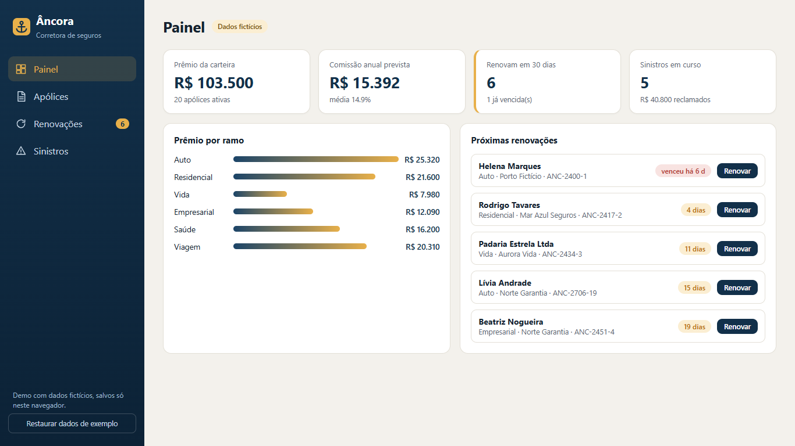
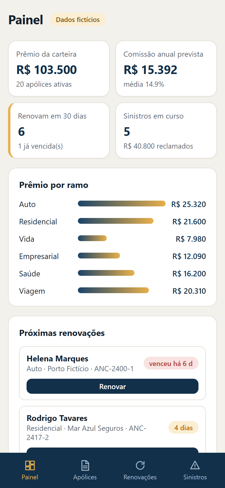

# Âncora · Insurance Brokerage CRM

A demo CRM for an insurance brokerage: policy book, renewal pipeline and claims tracking. Built with **Qwik** (client-side rendering) + TypeScript + Vite. All data is **fictional** and stays in your browser's `localStorage`.

**Live demo:** https://alissonlittig.github.io/ancora-corretora-crm/

| Desktop | Mobile |
|---|---|
|  |  |

## Features
- **Dashboard** – portfolio premium, expected commission, renewals due in 30 days, open claims, premium by line of business.
- **Policies** – search by client or policy number, filter by line, add new policies, due-date badges.
- **Renewals** – policies grouped by overdue / 30 / 60 / 90 days; one click renews (+1 year, +6% premium).
- **Claims** – stage board (Open → Under review → Approved → Paid, plus Denied); advance a claim with one click.
- Responsive down to 390 px with a bottom tab bar; reset button restores the sample data.

## Run it
```bash
npm ci
npm test        # vitest: renewal buckets, renew/advance logic, totals
npm run build   # type-check + production build into dist/
npm run dev
```

## Notes
- Qwik runs in CSR mode; the Qwik loader is copied into `public/qwikloader.js` because the bundler drops its side-effect import in production builds.
- `vite preview` is broken with this Qwik CSR setup; serve `dist/` with any static server instead.
- CI (GitHub Actions) runs tests and the build, then publishes to GitHub Pages.

Fictional brand and data, built as a portfolio piece. MIT licensed.
